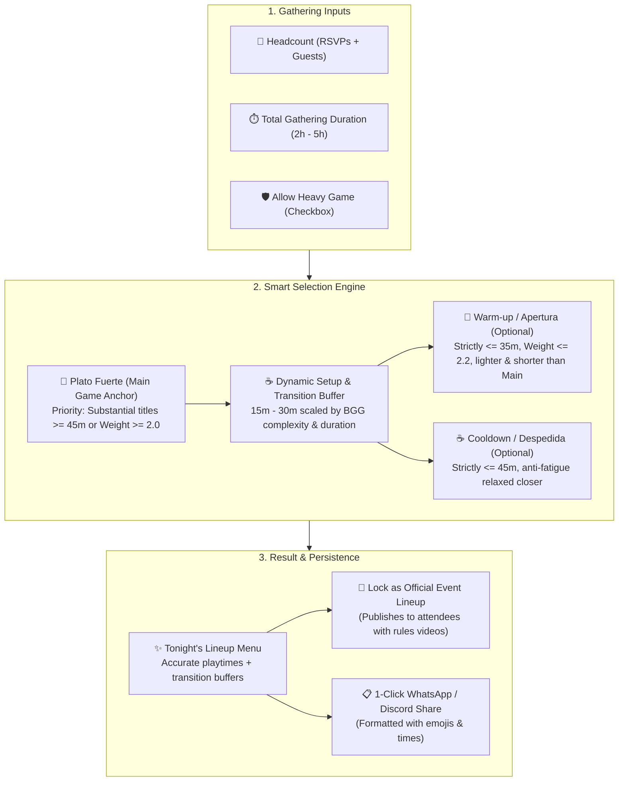
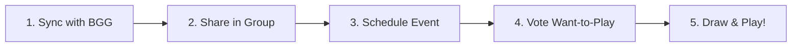

# Tablefolk

A friendly place to catalog board games, share selected games with a group, and draw a game for the number of people at game night.

[](https://www.typescriptlang.org/)
[](https://nextjs.org/)
[](https://fastify.dev/)
[](https://www.prisma.io/)
[](https://www.postgresql.org/)

---

## 📑 Quick Navigation

- [🍱 Evening Session Menu Planner](#-evening-session-menu-planner--anti-fatigue-engine)
  - [🧠 Hierarchy & Anti-Fatigue Rules](#-hierarchy--anti-fatigue-engine) · [☕ Dynamic Setup & Transition Buffers](#-dynamic-setup--intermission-buffers) · [💾 Saving & Sharing Lineups](#-saving-and-sharing-the-approved-lineup)
- [🗺️ How It Works](#how-it-works) · [✨ Key Features](#key-features)
- [📦 Local Setup](#local-setup)
  - [🐳 Docker Compose](#docker-compose) · [💻 Without Docker](#without-docker) · [🧪 Checks](#checks)
- [🚀 Deployment](#vercel) · [🎯 Future Roadmap](#️-future-roadmap--ideas)

---

## What is here

- `apps/web`: Next.js 16 app with design tokens, meeple illustrations, events room, session planner, and collection sync.
- `apps/api`: Fastify 5 API, Prisma schema, BGG sync, event RSVPs, weighted picker, dynamic buffer scheduler, and invitations.
- `packages/contracts`: shared input schemas, response types, and domain interfaces.
- `docs/designs/board-game-group-picker.md`: approved product and technical design.

The group collection shows each BGG game once and lists all members who share it. A game stays available while at least one member shares it. Expansions are independent choices. BGG is called only when searching for or syncing a collection; normal use reads the app database.

---

## 🍱 Evening Session Menu Planner & Anti-Fatigue Engine

Tablefolk includes an intelligent multi-game session orchestrator designed to plan a balanced 2 to 5-hour tabletop evening without cognitive burn. It structures the night into a satisfying narrative arc:



---

### 🧠 Hierarchy & Anti-Fatigue Rules

To prevent unbalanced sessions (e.g., an intense 60-minute cooperative game being suggested as a "Warm-up" before a 30-minute party game), the engine enforces strict structural rules:

> ⚡ **Session Architecture Rules:**
> - **🎯 Plato Fuerte (Main Game Anchor):** In sessions $\ge 90$ min, substantial games ($\ge 45$ min or weight $\ge 2.0$) take absolute priority as the centerpiece.
> - **🍕 Warm-up / Apertura:** Strictly capped at $\le 35$ min and weight $\le 2.2$ (Light). It must always be shorter and lighter than the Main Game ($duration \le mainDuration$ and $weight \le mainWeight$).
> - **☕ Cooldown / Despedida:** Capped at $\le 45$ min. If the Main Game was Heavy ($weight > 3.2$), the Cooldown is strictly restricted to light games ($weight \le 2.0$) to prevent brain burn.
> - **🛡️ Anti-Fatigue Limit:** Never more than **1 Heavy game** per session, and a maximum of **3 games** total per gathering.

---

### ☕ Dynamic Setup & Intermission Buffers

Real board game nights require downtime between boxes: packing up the previous game, setting up modular boards, dealing cards, grabbing snacks, and teaching rules. Tablefolk dynamically scales this buffer before each upcoming title:

| Category | BGG Criteria | Real Tabletop Overhead | UI Badge & Reason |
| :--- | :--- | :--- | :--- |
| 🔴 **Heavy / Epic** | Weight $\ge 3.2$ or Duration $\ge 90$m | Miniatures, multi-boards, draft screens & full rules teach (*Rising Sun*, *Brass*, *Scythe*) | `☕ 30m Setup & Rules Teach (Heavy game)` |
| 🟡 **Medium-Heavy** | Weight $\ge 2.6$ or Duration $\ge 70$m | Board setup & rules refresh (*Wingspan*, *Clank!*, *Catan* 5-6p) | `☕ 25m Table Setup & Rules Overview` |
| 🟢 **Medium Standard** | Weight $\ge 2.0$ or Duration $\ge 45$m | Standard board placement & shuffling (*WoW: Lich King*, *Ticket to Ride*) | `☕ 20m Intermission & Board Setup` |
| 🍕 **Light / Filler** | Weight $< 2.0$ and Duration $< 45$m | Fast deck shuffle, snack break & quick rules (*Avalon*, *Sushi Go!*) | `☕ 15m Quick Reset & Snack buffer` |

---

### 💾 Saving and Sharing the Approved Lineup

1. **Inside an Event (`/groups/[groupId]/events/[eventId]`):**
   - Click **`📌 Set as Official Event Lineup`**.
   - Locks the schedule to the top of the event page for all confirmed attendees with assigned carriers (`🎒 Bringer: [Member]`) and YouTube rules video links (`▶ Rules Video`).
2. **In Direct Group Game Night (`/groups/[groupId]/game-night`):**
   - Click **`📌 Save as Group Event`** to generate a group event with today's date and lock the lineup in 1 click.
   - Click **`📋 Copy Menu`** to copy a formatted roster with emojis and exact times directly into your WhatsApp, Discord, or Telegram group chat.

---

## How It Works



1. **Catalog & Sync**: Search BoardGameGeek or import your entire owned collection with one click, storing playtimes, player counts, edition names, and complexity ratings.
2. **Curate Group Shelves**: Share games into group tables. Copies are deduplicated automatically so each title appears once with all sharing owners and edition variants listed.
3. **Schedule Game Nights**: Any member can create an event with date, time, location, and host assignment. Attending members RSVP with guest counts (`+Guests`).
4. **Build Hype (Want-to-Play)**: Members allocate voting points to games they are excited to play (theirs or friends'). Points persist across sessions if a title is not drawn.
5. **Contextual Headcount Picker**: The picker filters games based on who is actually attending and which games can travel (host's home games are auto-eligible), applying duration and complexity filters with weighted odds. Winning games decay their points to rotate the library naturally!

---

## Key Features

- **Game Night Events & RSVPs**: Any group member can schedule game nights with date, time, location, and host assignment. Members RSVP (`Attending`, `Maybe`, `Declined`) with guest counts (`+Guests`), automatically calculating total table headcount.
- **Physical Availability & Edition Tracking**: Mark personal copies as available to travel, "Home only" (which automatically become eligible when hosting!), or unavailable (lent out, too heavy, under repair), plus track specific edition names.
- **BGG Collection Sync**: Connect your BoardGameGeek username to import or refresh your entire owned collection with one click, preserving BGG complexity ratings (weight), playtimes, and editions.
- **"Want to Play" Wishlist & Weighted Draw**: Members earn voting points to back games they want to see on table. Points accumulate across weeks and increase the game's odds in the event draw, resetting only upon victory to rotate the group's library naturally.
- **Contextual Event Picker**: Filters candidate games based on who is actually attending, excluding games that cannot travel unless hosted at the owner's home, with optional duration (`≤45m`, `≤90m`, `≤2h`) and BGG complexity filters.

---

## Local setup

### Docker Compose

Install Docker with Compose, then run from the repository root:

```sh
docker compose up --build
```

Open `http://localhost:3000`. Compose starts PostgreSQL, applies Prisma migrations (including events and wishlist tables), starts the API at `http://localhost:4000`, and runs the Next.js app. Source edits in `apps/web/src`, `apps/api/src`, and `packages/contracts/src` reload automatically. Database data persists in a Docker volume. The PostgreSQL port is available on `localhost:5432` with database, user, and password all set to `tablefolk` for local testing.

For signed-in features, copy `.env.example` to the root `.env` and fill in `NEXT_PUBLIC_CLERK_PUBLISHABLE_KEY` and `CLERK_SECRET_KEY` from the same Clerk development instance. Compose passes the web publishable key to the API unless `CLERK_PUBLISHABLE_KEY` is explicitly set. Compose reads these values from the root `.env`; values in `apps/web/.env.local` are used only by the non-Docker workflow. Without Clerk keys, the API health route and web setup page remain available, while authenticated API routes return a configuration error. Set `BGG_TOKEN` to test game searches and collection sync, and `RESEND_API_KEY` plus `RESEND_FROM_EMAIL` to test invitation emails. Clerk, BGG, and Resend remain external services. Register `http://localhost:3000` in Clerk as an allowed local origin and redirect target. Compose always uses its own PostgreSQL service, regardless of database URLs in `.env`.

Stop the stack with `docker compose down`. To discard its local database and regenerate the development volumes, run `docker compose down -v`. Rebuild with `docker compose up --build` after changing dependencies or files outside the mounted source and Prisma directories.

If signed-in API requests return 401 and the API logs `session-token-nbf`, sync the host computer's clock. Docker containers use the host clock, and Clerk rejects tokens that appear to be from the future. After the clock is corrected, sign out and back in to refresh the session.

### Without Docker

Use Node 22 and Corepack. Install dependencies from the repository root:

```sh
corepack pnpm install
```

Copy `.env.example` to `.env`. Keep the existing `BGG_TOKEN` in the root `.env`. Fill in the remaining API values: a PostgreSQL `DATABASE_URL` (and `DIRECT_URL` for migrations when using a pooler), Clerk keys, Resend credentials and verified sending address. Neon’s Vercel integration supplies `DATABASE_URL_UNPOOLED`, which Prisma can also use for migrations. Copy the `NEXT_PUBLIC_*` and `CLERK_SECRET_KEY` values to `apps/web/.env.local`; Next.js reads that file for local web development. Set `NEXT_PUBLIC_API_URL` to `http://localhost:4000` and `WEB_ORIGIN`/`PUBLIC_WEB_URL` to `http://localhost:3000` locally. Never commit either env file.

In Clerk, enable email/password and Google sign-in, then register the local and deployed web URLs as allowed origins and redirect targets. Create a PostgreSQL database and run:

```sh
corepack pnpm db:generate
corepack pnpm db:migrate
```

Start the two processes in separate terminals:

```sh
corepack pnpm dev:api
corepack pnpm dev:web
```

Open `http://localhost:3000`. The home page and setup notice work before credentials are configured; collection and group actions require the services above.

---

## Checks

```sh
corepack pnpm typecheck
corepack pnpm test
corepack pnpm build
```

The tests cover picker filtering (headcount, duration, BGG weight), deduplication, weighted draws, rerolls, and BGG parsing. Full signed-in and email flows require test accounts and service credentials.

---

## Vercel

Create two Vercel projects from this repository. Set their root directories to `apps/web` and `apps/api`. Keep the workspace lockfile and `packageManager` setting at the repository root. Choose Next.js for the web project and Fastify for the API project; Vercel detects the API entry point at `src/index.ts`. Use Node 22. Each app's build script compiles the shared contracts package before building itself. Vercel should install the workspace dependencies from the root lockfile.

Set `NEXT_PUBLIC_API_URL` to the API's HTTPS URL and set `WEB_ORIGIN` and `PUBLIC_WEB_URL` to the web project's HTTPS URL. Put `BGG_TOKEN`, database URLs, Resend credentials, `CLERK_PUBLISHABLE_KEY`, and `CLERK_SECRET_KEY` only in the API project. The web project needs `NEXT_PUBLIC_CLERK_PUBLISHABLE_KEY` and its own `CLERK_SECRET_KEY` for Clerk's Next.js integration. Keep preview and production databases separate. Configure matching allowed origins and redirect URLs in Clerk. A preview deployment with no credentials displays the public home page and a setup notice, but collection, groups, invitations, and picks cannot run.

Apply migrations to each environment before deploying code that needs them:

```sh
corepack pnpm --filter @tablefolk/api db:deploy
```

Confirm the BGG application license covers the intended public use and storage of text and cover images before launch. Set `BGG_COVER_STORAGE_ALLOWED=true` in the API project only after cover storage is approved. Covers are downloaded once when a game is imported, stored in PostgreSQL, and served by the API; collection views do not call BGG. The site displays BGG's linked credit image in the footer and game search, and each game links to its source. If cover copying is unavailable, Tablefolk uses its own placeholder. Configure a verified Resend sending domain before trying invitations.

See [operations](docs/operations.md) for deployment and recovery details.

---

## 🗺️ Future Roadmap & Ideas

Tablefolk continues to evolve from a game picker into a complete Game Night Operating System. Key features envisioned for future releases include:

- **📊 Play Logger & Group Leaderboards**: Record winners, final scores, and play durations after each game night; automatically sync sessions to BGG Plays (`/xmlapi2/plays`) and maintain group win-rate leaderboards.
- **🪑 Multi-Table Splitter (*Split Tables*)**: Intelligent auto-division for large gatherings (8–16+ attendees) into balanced parallel tables (e.g., 4-player strategy heavy game + 6-player social party game).
- **🍕 Potluck / Snack Board**: Collaborative RSVP checklists for food and drinks to coordinate table snacks.
- **🧙‍♂️ Campaign & Legacy Tracker**: Episodic progress saving for campaign games (*Gloomhaven*, *Pandemic Legacy*, *Arkham Horror LCG*), keeping track of the table lineup.
- **📱 PWA & Offline Table Mode**: Native-like installation on mobile devices with local caching for cabin/basement play sessions without reliable internet.
- **🎯 BGG Community "Best at X Players"**: Background polling of community player count votes to highlight games at their optimal table size.
