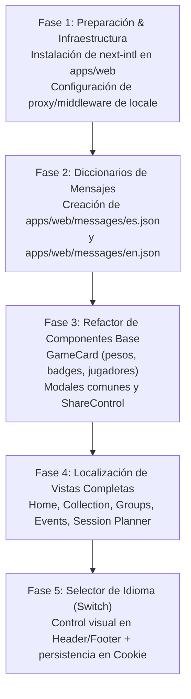

# Estrategia de Internacionalización (i18n) & Definición de Alcance

* **Fecha de definición:** 2026-11-15
* **Estado:** Aprobado en Roadmap
* **Ámbito:** Frontend (`apps/web`) y Contratos (`packages/contracts`)

---

## 1. Decisión Arquitectónica (ADR)

### 1.1 Contenido de BoardGameGeek (BGG): Mostrar "Tal Cual" (As-is)
* **Decisión:** Los datos importados o sincronizados desde BoardGameGeek se mostrarán **tal cual vienen de la fuente original** sin traducción automatizada ni alteración.
* **Elementos cubiertos por esta regla:**
  * **Título del juego (`game.name`):** Título primario oficial de BGG.
  * **Categorías y Mecánicas (`categories`, `mechanics`):** Nombres canónicos de BGG (ej. *Worker Placement*, *Hand Management*, *Drafting*).
  * **Sinopsis y Descripción (`description`):** Texto original en inglés provisto por BGG.
  * **Nombre de edición (`versionName`):** Versión identificada por BGG o ingresada libremente por el dueño.
* **Justificación:** Los aficionados a los juegos de mesa ya reconocen los términos estándar de la industria (mecánicas, títulos principales, ediciones). Evitar traducciones forzadas preserva la exactitud técnica de los metadatos y evita inconsistencias con las referencias internacionales de BGG.

### 1.2 Alcance del i18n: Interfaz de Usuario (UI) de Tablefolk
* **Decisión:** La internacionalización se aplicará exclusivamente a la **capa de experiencia de usuario (UI)** de la aplicación web y mensajes del sistema.
* **Idiomas soportados inicialmente:** Español (`es`, default/prioridad) e Inglés (`en`).
* **Librería técnica seleccionada:** `next-intl` (compatible de forma nativa con Next.js 16 App Router, RSC y Client Components).

---

## 2. Alcance Detallado de Traducción (UI)

| Componente / Módulo | Elementos a Internacionalizar |
| :--- | :--- |
| **Navegación & Layout** | Barra superior, pie de página, enlaces de navegación, perfil de usuario, créditos de BGG. |
| **Página Principal (Home)** | Hero, tarjetas de propuesta de valor, llamadas a la acción (*Start your collection*, etc.). |
| **Colección (`/collection`)** | Filtros (Todos, Base, Expansiones, Disponibles, No disponibles), barra de búsqueda, selector de orden, botón de sincronizar BGG, estados de carga y modales de edición. |
| **Tarjetas de Juego (`GameCard`)** | Rango de jugadores (`"2–4 jugadores"`, `"hasta X con expansión"`), etiquetas de peso (`"Ligero"`, `"Medio"`, `"Pesado"`), etiquetas de tipo (`"Expansión"`, `"Expansión autojugable"`), estado de disponibilidad. |
| **Grupos (`/groups`)** | Listado de grupos, creación de nuevo grupo, miembros, biblioteca compartida, controles de compartir. |
| **Noche de Juegos & Planificador de Sesión** | Filtro de headcount, generador de menú anti-fatiga, etiquetas de buffers (`"☕ 20m Preparación de mesa y reglas"`), botones de compartir en WhatsApp / Discord. |
| **Eventos (`/groups/[groupId]/events`)** | Fechas, estados de RSVP (`"Asistiré"`, `"No asistiré"`, `"Tal vez"`), acompañantes adicionales, oficialización de juego. |
| **Autenticación (Clerk)** | Localización en español mediante `@clerk/localizations/esES`. |

---

## 3. Plan de Implementación (Roadmap Técnico)



### Fase 1: Infraestructura
1. Agregar `next-intl` a `apps/web/package.json`.
2. Configurar `requestConfig` en `apps/web/src/i18n/request.ts` para resolución de mensajes según la cookie `NEXT_LOCALE` o encabezado `accept-language`.

### Fase 2: Estructura de Diccionarios
```
apps/web/messages/
├── es.json
└── en.json
```
Organizados por dominios (`common`, `navigation`, `collection`, `gameCard`, `groups`, `events`, `sessionPlanner`).

### Fase 3 & 4: Migración Progresiva de Vistas
* Reemplazar cadenas hardcodeadas por `const t = useTranslations(...)` en clientes y componentes.
* Utilizar formateadores numéricos y de fechas integrados de `next-intl` (para fechas de eventos y duraciones).

### Fase 5: Selector de Idioma
* Componente dropdown minimalista `LanguageSelector` en el encabezado.
* Guarda preferencia en `NEXT_LOCALE` con recarga reactiva sin perder estado de navegación.
